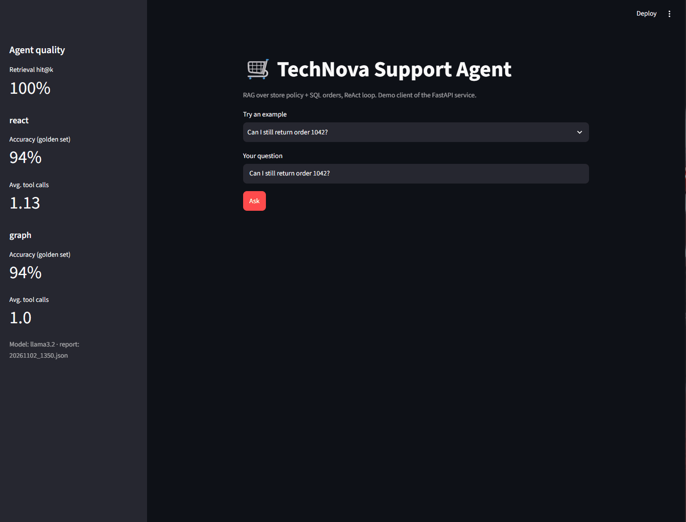

# TechNova RAG Agent




A customer-support agent for **TechNova**, a fictional electronics store. It answers questions from two sources and decides on its own which one it needs:

- **store policy documents** (returns, delivery, warranty, payments) through RAG over a vector database,
- **the orders database** (SQL) through a read-only tool.

The agent exists in two versions with the same tools: a **hand-written ReAct loop** (to understand the mechanism) and a **LangGraph** graph with a step limit and conversation memory. Business decisions such as return eligibility and the delivery fee are made **in code**; the LLM only explains them.

> Status: both agents work and are evaluated on the same 31-question golden set; FastAPI, Docker, tests, CI and a Streamlit demo are in place. Next steps are in [ROADMAP.md](ROADMAP.md).

## Results at a glance

Golden set of 31 questions, `llama3.2` running locally, frozen date for reproducible answers:

| | One-step baseline | ReAct loop | LangGraph |
|---|---|---|---|
| **Correct answers** | 28/31 (90%) | **29/31 (94%)** | **29/31 (94%)** |
| Tool calls per question | 1.0 | 1.13 | **1.0** |
| Forced answers (repeated tool or step limit) | – | 23% | **0%** |
| Retrieval hit@2 | 100% | 100% | 100% |

Both agents answer the same share of questions. LangGraph never hit the step limit and made fewer tool calls; one likely reason is native tool calling, which replaces the JSON the loop has to parse. Details are in [Evaluation](#evaluation).

The 23% forced answers in the ReAct loop come from the one-call-per-tool rule: the model asks for the same tool again, the code blocks it and forces an answer from the context it already has. All 7 forced answers in the latest run were still correct. LangGraph has no such rule (only a recursion limit), so part of the 23% vs 0% gap comes from this difference.

## Example

A two-turn conversation with the LangGraph agent. The second question only makes sense with memory:

```
Customer: What is the status of order 1043?
  get_order(order_id=1043) -> shipped, return_status: "Not delivered yet: return possible within 30 days after delivery."
Agent:    The status of order 1043 is shipped. You are eligible for a return within 30 days after delivery. ...

Customer: Can I return it?
  search_policy(query="returns") -> store_policy.txt / Returns
Agent:    Yes, you can return the order within 30 days of receiving the delivery. The product must be unused and in its original packaging. ...
```

## Question types

| Type | Example | Source |
|------|---------|--------|
| Policy | How long is the warranty? | documents (RAG) |
| Order | What is the status of order 1043? | SQL |
| Mixed | Can I still return order 1042? | order + business rule |
| Not in data | Do you ship to Japan? | none → "I don't have this information" |
| Missing info | Where is my order? | none → ask for the order number |

## Architecture

Both agents share the same tools in `src/agent/tools.py`. They differ in how the loop is run.

**ReAct loop** (`src/agent/react.py`): the LLM returns JSON, the code parses it, runs the tool and adds the result to the history. Each tool is allowed once; after `max_steps` the code forces a final answer.

**LangGraph** (`src/agent/graph.py`): the same loop expressed as a graph.

```
START -> agent --(tool call?)--> tools --+
           ^         | no                |
           |         v                   |
           |        END                  |
           +-----------------------------+
```

- `agent`: the LLM with tools bound through native tool calling (`bind_tools`); it either answers or asks for a tool.
- `tools`: `ToolNode` runs the requested tool and adds the result to the state (the message list).
- `tools_condition` routes to `tools` or ends the run; `recursion_limit` stops a loop that never ends and the customer gets a fallback message instead of an error.
- A checkpointer with a `thread_id` stores each conversation, so follow-up questions such as "Can I return it?" work.

| Component | File |
|-----------|------|
| Settings from environment variables | `src/config.py`, `.env.example` |
| RAG: chunking, indexing, search | `src/rag/pipeline.py` |
| Tools: `search_policy`, `get_order` | `src/agent/tools.py` |
| ReAct loop + CLI | `src/agent/react.py` |
| LangGraph agent + adapter for the evaluation | `src/agent/graph.py` |
| One-step baseline agent | `src/agent/router.py`, `src/agent/agent.py` |
| Evaluation | `src/eval/run_eval.py`, `data/eval/golden_set.json` |
| Prompts (not in code) | `config/prompts/*.txt` |
| HTTP API (FastAPI) | `src/api/main.py`, `src/api/schemas.py` |
| Tests, container, CI | `tests/`, `Dockerfile`, `.github/workflows/ci.yml` |

## Quickstart

Requirements: Python 3.13, [uv](https://docs.astral.sh/uv/), [Ollama](https://ollama.com/).

```bash
ollama pull llama3.2
uv sync
cp .env.example .env

uv run --env-file .env python -m scripts.create_db      # create the orders database
uv run --env-file .env python -m src.rag.pipeline       # build the vector index

uv run --env-file .env python -m src.agent.react "Can I still return order 1042?"   # ReAct loop
uv run --env-file .env python -m src.agent.graph        # LangGraph: demo conversation with memory
uv run --env-file .env streamlit run src/ui/streamlit_app.py   # Streamlit demo

# evaluation with a frozen date (reports are saved to data/eval/results/)
TODAY=2026-10-26 uv run --env-file .env python -m src.eval.run_eval --agents react graph

uv run ruff check .        # lint
uv run pytest -v           # tests (no LLM needed)
```

**Docker:** `docker compose up --build`, then open http://127.0.0.1:8000/docs. Ollama keeps running on your machine; the container reaches it through `host.docker.internal`.

## API

| Endpoint | Description |
|----------|-------------|
| `POST /api/ask` | `{"question": "..."}` → `{"answer", "steps", "forced"}`; 422 for invalid input, 503 if the LLM is unavailable |
| `GET /api/health` | liveness check (used by the Docker healthcheck) |
| `GET /api/eval/latest` | latest evaluation report: hit@k and accuracy / tool calls **per agent** (e.g. ReAct loop and LangGraph); 404 if there is no report |

## Tests and CI

- **Tool tests** check the business decisions without an LLM: an order of exactly $70.00 pays for delivery, a 38-day-old order cannot be returned, an unknown order returns an error, weak chunks are dropped. Each test builds its own SQLite database and freezes "today".
- **API tests** replace the agent with a mock, so they run in under a second.
- The embedding model and Chroma are **lazy-loaded**, which cut test time from ~6.8 s to ~0.7 s and lets CI run without the model.
- **CI** (GitHub Actions) runs Ruff and pytest on every push. Model quality is measured separately by the evaluation.
- A regression test reproduces a fixed bug: a report with only the LangGraph agent used to crash `/api/eval/latest` (`KeyError`); the endpoint now reads whichever agents the report has.

## Evaluation

### Method

- **Golden set:** 31 questions in 5 categories (10 policy, 6 order, 8 mixed, 4 not in data, 3 missing info), each with expected facts (several accepted wordings), expected tools and, for policy questions, the expected section.
- **Correctness:** the answer must contain an accepted wording of every expected fact, matched as **whole words** (`no` does not match `know`).
- **Retrieval hit@k** is measured without the LLM, so a wrong answer can be traced to the retriever or to the model.
- Also measured: tool choice, tool calls per question, forced answers, latency. Each run saves every answer as JSON.
- Both agents run through the same harness; the LangGraph agent is wrapped in an adapter that returns the loop's output format, and every question gets its own `thread_id` so answers do not leak between questions.

### Current results

| Metric | Baseline | ReAct loop | LangGraph |
|---|---|---|---|
| Correct, overall | 90% | **94%** | **94%** |
| Policy | 100% | 90% | **100%** |
| Order | 100% | 100% | 100% |
| Mixed | 88% | **100%** | 88% |
| Not in data | 100% | 75% | 75% |
| Missing info | 33% | **100%** | **100%** |
| Tool calls per question | 1.0 | 1.13 | **1.0** |
| Forced answers | – | 23% | **0%** |

ReAct and LangGraph were run on the same machine (both ~1.5 s per answer); the baseline comes from an earlier run on a slower machine.

### Error analysis

| Agent | Question | Error type | Cause |
|---|---|---|---|
| LangGraph | "Is the smartwatch from order 1042 still under warranty?" | skipped second tool | answered from one tool, so "24 months" is missing |
| LangGraph | "Do you ship to Japan?" | hallucination from related context | the Delivery section passes the threshold and the model adds "Japan" |
| ReAct | "Do you have a store in Krakow?" | wrong "no" instead of "I don't know" | the policy says nothing about stores |
| ReAct | "Who pays for return shipping?" | incomplete answer | "unless the product is damaged" left out |

### History of changes

| Version | Change | Baseline | ReAct | LangGraph |
|---|---|---|---|---|
| v1 | first run (substring grading) | 20/30 | 21/30 | – |
| v1b | **whole-word grading**, same answers re-graded | 18/30 | 20/30 | – |
| v2 | **similarity threshold** 0.35 in `search_policy` | 24/30 | 23/30 | – |
| v3 | **delivery decision in code**, **one call per tool**, edge case at exactly $70.00 | 22/31 | 24/31 | – |
| v4 | verdict-first `delivery_status`; grade the return verdict, accept more wordings | 28/31 | 29/31 | – |
| v5 | **LangGraph agent**; `return_status` for orders not delivered yet; short policy queries; one grading fix ("November 19th") | – | 29/31 | **29/31** |

- **v1 → v1b:** the first grader was too lenient. Fixing it lowered the scores but made them honest.
- **v2:** the threshold was chosen from measured scores (answerable questions ≥ 0.40, unanswerable ≤ 0.30) and cut invented answers.
- **v3:** one call per tool cut tool calls from 2.2 to 1.06 per question and latency from 8.1 s to 5.0 s. Added a 31st question to test the edge case of an order of exactly $70.00 (the free-delivery threshold).
- **v5:** the first LangGraph run scored 28/31, but one failure was a grading error ("November 19th" did not match "November 19"). A prompt rule meant to fix the warranty question broke a return question that had passed, so it was reverted.

### Limitations of the evaluation

- **The agents were tuned on the same 31 questions they are evaluated on**, so 94% is optimistic. A held-out set is on the roadmap.
- One question is ~3 percentage points; keyword grading checks facts, not tone or completeness.
- The golden set has single questions only; memory is tested by hand.

## Design decisions

| Decision | Alternative | Why |
|----------|-------------|-----|
| Chroma for documents, SQLite for orders | one vector DB | documents are searched by meaning, orders by exact ID |
| Hand-written loop first, then LangGraph | LangGraph from day one | understand the mechanism, then compare on the same test set |
| Return and delivery decisions in code (`return_status`, `delivery_status`) | LLM compares numbers with the policy | the model said "yes" for a 38-day-old order with a 30-day window. **Code decides, the LLM explains.** |
| Decision sentences start with the verdict ("Return NOT possible: ...") | negation in the middle | the small model missed the negation |
| Similarity threshold for retrieved chunks | always pass top-k | weakly related paragraphs led to invented answers |
| Tool description asks for short policy topics | free-form queries | "returning a USB-C charger" scored 0.30, "returns" scores above the 0.35 threshold |
| Step limit with a fallback answer | stronger prompt only | a stricter prompt did not stop the loop; a rule in code always works |
| Native tool calling in LangGraph | JSON in the prompt | no JSON to parse; 0% forced answers in the evaluation (the graph has no one-call-per-tool rule) |
| Frozen date (`TODAY`) for evaluation | real date | reproducible results |
| Read-only SQL connection + `?` parameters | regular connection | no writes, no SQL injection |

Smaller choices: prompts live in `config/prompts/`, settings come from environment variables, chunks are indexed with stable IDs (`upsert`), the Docker image uses CPU-only PyTorch and has the model and index built in, and the uv version is pinned in Docker and CI.

## What didn't work

- **One-step router on mixed questions.** "Can I still return order 1042?" got a confident answer from the policy alone, without checking the order. Fixed by the agent loop.
- **Prompt rules for number comparison.** Three prompt versions did not stop wrong answers about the return window (0/3). A ready-made sentence in the tool result fixed it: for a small model, the form of the data matters more than instructions.
- **The loop did not stop.** The model kept repeating tool calls until the step limit. A prompt rule did not help; a forced answer in code did.
- **Example bias.** The model copied values from tool examples in the prompt (`get_order(1042)` for another customer). Fixed with placeholders.
- **Product names in policy queries.** In a follow-up ("Can I return it?") the model searched for "returning a USB-C charger", which scored 0.30 against the Returns section (0.72 for "Can I return a product?"). Lowering the threshold was risky because an unrelated chunk also scores 0.30. Fixed by asking for short policy topics in the tool description; the model now searches for "returns".
- **Invented return decision for orders in transit.** For a shipped order, `get_order` returned no `return_status`, so the model invented "you won't be able to return it". Fixed by computing a status for every order (issue #2).
- **A prompt fix that caused a regression.** A rule telling the model to call both tools for order + policy questions did not fix the warranty question and broke a return question that had passed. Reverted after the full evaluation showed it.
- **Memory is stored, but not always used.** In "What is the status of order 1043?" → "And when was it ordered?", the agent resolves "it" to order 1043 but searches the policy instead of reading `order_date` from the earlier tool result. Not fixed yet.

## Security and limitations

- **No authentication in the MVP.** Anyone who knows an order number can see that order and the customer's name. In production, lookups must be scoped to the logged-in customer, with the customer ID taken from the session, never from text sent to the LLM.
- `POST /api/ask` returns full tool results in `steps` for debugging; a customer-facing deployment should return only the answer.
- No search by customer name, on purpose (privacy).
- The conversation memory is in RAM (`InMemorySaver`) and disappears on restart; a database-backed checkpointer is needed in production.
- Runs on a small local model (`llama3.2`), so some answers are incomplete.


## Author

**Michał Litwin** · [LinkedIn](https://www.linkedin.com/in/mlitwin1/) · [GitHub](https://github.com/michallitwin)

Also see [PhishGuard Live](https://github.com/michallitwin/phishguard-live), a phishing-domain detector with FastAPI, Docker and CI.